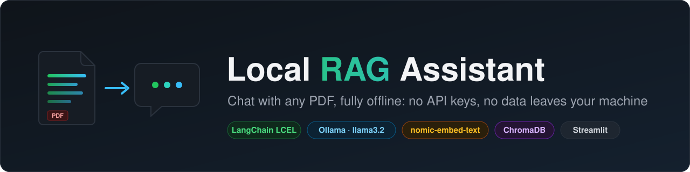
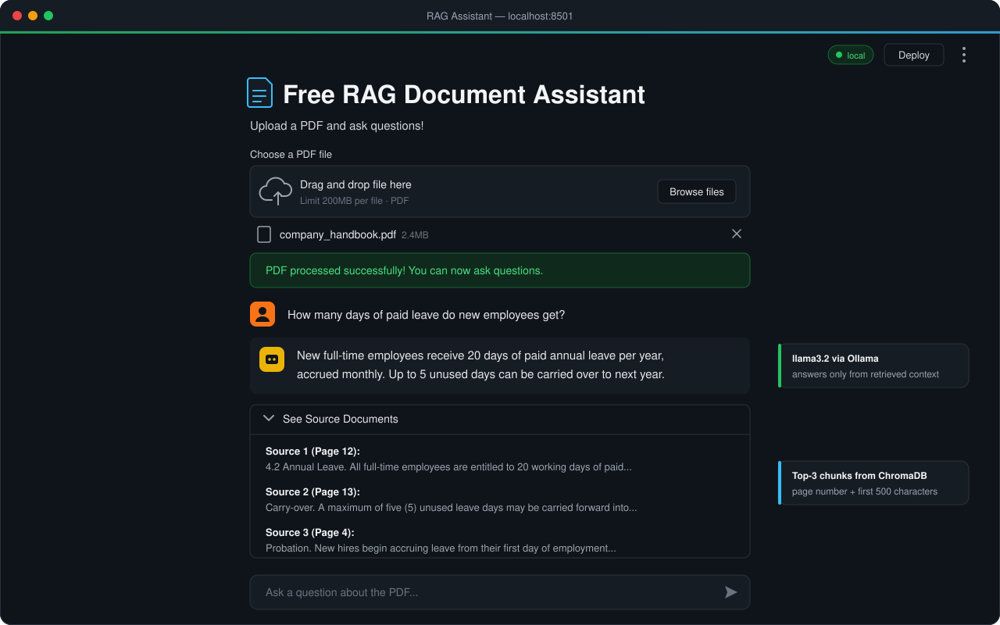
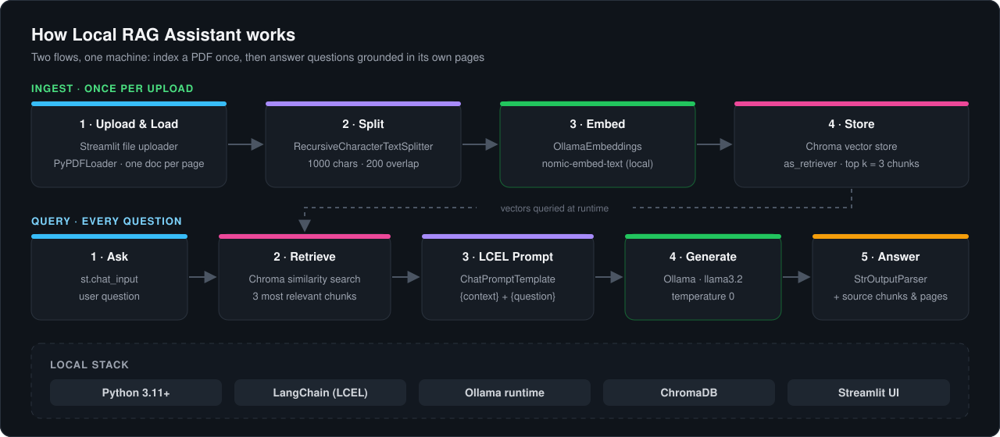

  

  
  
  
  
  

# 🖥️ Local RAG Document Assistant

A 100% local, private, and free Retrieval-Augmented Generation (RAG) application. Upload any PDF and ask questions about its contents without sending your data to external APIs.

  
   
  Upload a PDF, ask in plain English, and get an answer from a local llama3.2 model with the exact source pages it used.

## ✨ Key Features
- **100% Local & Private:** No API keys, no data leaves your machine.
- **Modern LangChain Architecture:** Built using LangChain Expression Language (LCEL) for clean, modular, and production-ready code.
- **Dual Local AI Stack:** 
  - **Embeddings:** `nomic-embed-text` via Ollama for lightning-fast vectorization.
  - **Generation:** `llama3.2` via Ollama for intelligent, context-aware answers.
- **Source Tracking:** Displays the exact PDF chunks and page numbers used to generate the answer, ensuring transparency and reducing AI hallucinations.

## ⚙️ How It Works

  

## 🛠️ Tech Stack
- **Python 3.11+**
- **LangChain** (Core, Community, Text Splitters)
- **Ollama** (Local LLM & Embedding inference)
- **ChromaDB** (Local Vector Database)
- **Streamlit** (Interactive Web UI)

## 🚀 Getting Started

### Prerequisites
1. Install [Ollama](https://ollama.com/download) on your machine.
2. Pull the required local models via your terminal: